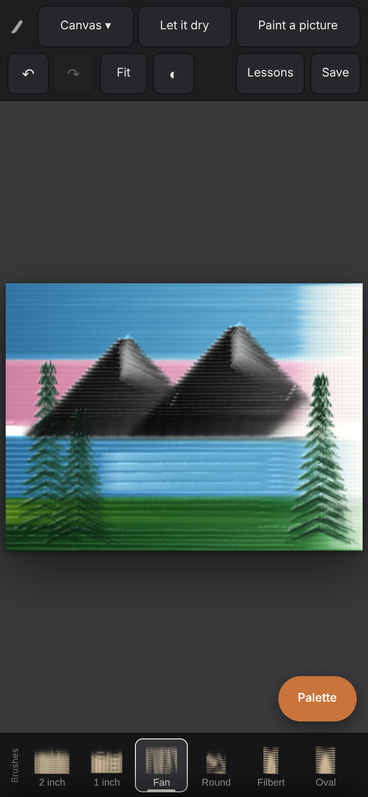
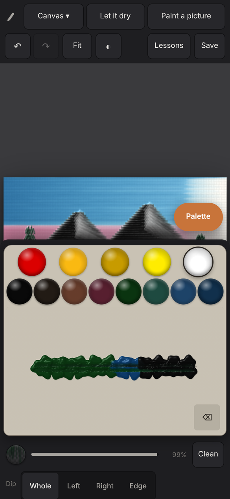
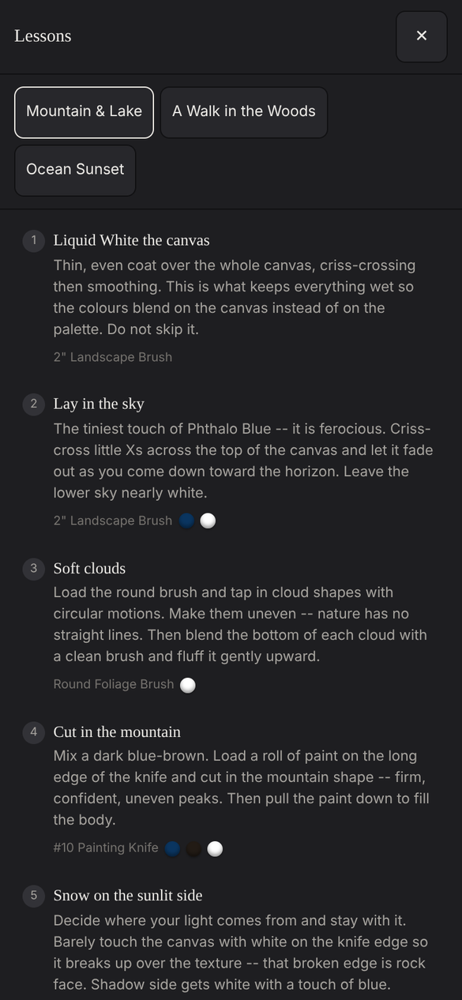

# Wet Canvas — digital oil studio

A wet-on-wet oil painting simulator that runs in your browser, for anyone who
wants to try oil-style landscape painting — mixing, blending, thick paint —
without buying a single tube.

### **[Open the app →](https://candanumut.github.io/Canvas/)**

Works on a computer, a tablet or a phone, with a pen, a mouse or a finger.
A tablet or computer gives you the most room to paint.

<p>
  
  
  
</p>

## What you get

- **Paint that behaves like wet oil.** Colours blend on the canvas, a brush
  picks up the paint it passes through, and thick paint builds raised texture
  that catches a light you can move.
- **Real pigment mixing.** Thirteen classic landscape colours (Titanium White,
  Phthalo Blue, Van Dyke Brown and the rest). Blue and yellow make green, not
  grey, and a touch of Phthalo Blue overpowers a pile of white, as it does in
  real life. You mix on a palette board with the brush itself.
- **Brushes and knives.** 2" and 1" landscape brushes, fan, round, filbert,
  oval, script liner, detail round, two painting knives, a scraper, a dry
  blender, a rag and a colour picker. Sizes are in inches.
- **Guided lessons.** Three landscapes (mountain lake, winter woods, ocean
  sunset), step by step. Each step hands you the right tool and colours.
- **Paint a picture.** Give it a photo and it paints it, stroke by stroke,
  with the same brushes.
- Undo and redo, "let it dry" for layering, pen pressure on a stylus, and
  save as PNG.

**Private by design.** Everything runs on your device. Your painting is kept
only in your own browser (IndexedDB), so it is still there when you come back.
Photos you give "Paint a picture" are read on your device and never uploaded.
No accounts, no analytics, no ads. Clearing the site's data clears the
painting.

## Painting with it

1. **Base coat first.** Pick *White base* when you start. It keeps the
   canvas wet so everything you paint after it blends.
2. **Pick a colour.** Tap a colour on the palette. That squeezes a fresh pile
   onto the board and loads your brush with it.
3. **Mix for real.** Drag the brush through two piles on the board. What is
   on the bristles is a real mixture, and it goes onto the painting.
4. **Work back to front.** Sky, far mountains, hills, trees, water, then the
   ground in front, then small details. The **Lessons** panel walks you
   through three paintings this way.
5. **Let it dry** when you want the next layer to sit on top instead of
   blending in.

The [long guide](docs/how-it-works.md) covers every tool, the keyboard
shortcuts, how the paint simulation works and how the code fits together.
There is also a write-up of the research and what went wrong along the way:
[docs/simulating-oil-paint.md](docs/simulating-oil-paint.md).

## Run it yourself

It is a static site with no build step and no dependencies.

```sh
git clone https://github.com/CandanUmut/Canvas.git
cd Canvas
python3 -m http.server 8000      # or any static server
# then open http://localhost:8000
```

A server is needed only because the code uses ES modules, which browsers
refuse to load over `file://`.

It needs a browser with **WebGL2** and floating-point render targets: current
Chrome, Edge, Firefox or Safari. If WebGL2 is missing, the app says so plainly.

`.github/workflows/pages.yml` publishes the repository root to GitHub Pages on
every push to `main`.

## Credits

Pigment mixing uses [spectral.js](https://github.com/rvanwijnen/spectral.js) by
Ronald van Wijnen (MIT) — see `src/vendor/LICENSE-spectral.txt`. The GLSL port
is vendored as `src/vendor/spectral.glsl.js`.

Inspired by the wet-on-wet technique popularised on TV painting shows; not
affiliated with any brand.

## License

MIT — see [LICENSE](LICENSE).
